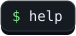
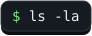
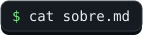
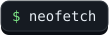
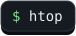
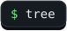
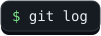
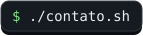

<!-- Este README é gerado por .github/terminal/shell.mjs — edite o script, não este arquivo. -->

  

  
  
  
  
  
  
  
  

  <a href="https://github.com/Brunoo47/Brunoo47/issues/new?title=%24%20&body=Digite%20seu%20comando%20no%20**t%C3%ADtulo**%2C%20depois%20do%20%60%24%20%60%20(ex.%3A%20%60%24%20cat%20sobre.md%60%2C%20%60%24%20cd%20projetos%60%2C%20%60%24%20git%20log%60).%0A%0ADepois%20%C3%A9%20s%C3%B3%20clicar%20em%20**Create**.%20N%C3%A3o%20sabe%20por%20onde%20come%C3%A7ar%3F%20Use%20%60%24%20help%60."><b>⌨️ Digitar meu próprio comando</b></a>

<code>$ who</code> — passaram por este terminal  

Como isso funciona?

 

Cada botão abre uma issue com o título <code>$ comando</code>. Um <a href="./.github/workflows/terminal.yml">GitHub Action</a> executa o comando num <a href="./.github/terminal/fs.mjs">filesystem virtual</a>, guarda a sessão (compartilhada entre todos os visitantes — se alguém der <code>cd</code>, todo mundo muda de pasta), redesenha o terminal em SVG com a animação de digitação e responde na sua issue com a saída. Os dados de <code>htop</code>, <code>neofetch</code> e <code>git log</code> vêm da API do GitHub em tempo real.

Atualizado em 10/11/2026, 07:27

