 

 

  <picture>
    <source media="(prefers-color-scheme: dark)" srcset="./assets/neofetch-dark.svg" />
    
  </picture>

   
  

## 🎮 4 em Linha

**Você contra a minha IA, aqui mesmo no perfil.** Escolha uma coluna, confirme a issue e em ~30s a IA responde. Todo mundo joga a mesma partida.

<!-- 4EMLINHA:START -->

  <picture>
    <source media="(prefers-color-scheme: dark)" srcset="./assets/4emlinha-dark.svg?v=1-0" />
    
  </picture>

  
  
  
  
  
  
  

<b>Tabuleiro novinho. Faça a primeira jogada!</b>

<table>
<tr>
<td valign="top" width="58%">

**🕹️ Últimas jogadas**

_Ninguém jogou ainda. Seja o primeiro!_

</td>
<td valign="top" width="42%">

**📈 Mais ativos**

_vazio_

**🏆 Hall da Fama** — venceram a IA

_Ninguém venceu a IA ainda. 👀_

</td>
</tr>
</table>

<b>Como funciona?</b>

 

1. Você clica numa coluna → abre uma issue com o título `4emlinha|jogar|N`.
2. Um [GitHub Action](./.github/workflows/4emlinha.yml) lê a jogada, valida e aplica no tabuleiro.
3. A IA ([negamax com poda alfa-beta](./.github/scripts/connect4.mjs), 6 jogadas de profundidade) escolhe a resposta.
4. O Action redesenha o SVG, atualiza este README, comenta na sua issue e a fecha.

Todo mundo joga junto contra a mesma IA. Quem fizer a jogada da vitória entra pro Hall da Fama.

<!-- 4EMLINHA:END -->

## 📊 Dashboard

  <picture>
    <source media="(prefers-color-scheme: dark)" srcset="./assets/dashboard-dark.svg" />
    
  </picture>

  <picture>
    <source media="(prefers-color-scheme: dark)" srcset="./assets/3d-dark.svg" />
    
  </picture>

## 🚀 Projetos em destaque

<table>
  <tr>
    <td width="50%" valign="top">
      <h3>🚒 <a href="https://github.com/Brunoo47/Sistema-Bombeiros">Sistema Bombeiros</a></h3>
      
Sistema web para o Corpo de Bombeiros de Guaramirim — front-end do sistema de gestão.

      
      
    </td>
    <td width="50%" valign="top">
      <h3>🗄️ <a href="https://github.com/Brunoo47/Django">Bombeiros · API</a></h3>
      
Banco de dados e back-end em Django do sistema dos bombeiros de Guaramirim.

      
      
      
    </td>
  </tr>
  <tr>
    <td width="50%" valign="top">
      <h3>🤖 <a href="https://github.com/Brunoo47/demolay-ai-assistant">DeMolay AI Assistant</a></h3>
      
Agente de IA que responde dúvidas sobre a Ordem DeMolay.

      
      
    </td>
    <td width="50%" valign="top">
      <h3>☁️ <a href="https://github.com/Brunoo47/app-aws">app-aws</a></h3>
      
Projeto base para integrar serviços da AWS com PHP e AWS SDK.

      
      
      
    </td>
  </tr>
</table>

 

  <picture>
    <source media="(prefers-color-scheme: dark)" srcset="./assets/snake-dark.svg" />
    
  </picture>

Tudo nesta página é gerado por <a href="./.github/scripts">scripts próprios</a> no GitHub Actions — sem serviços de stats de terceiros.

