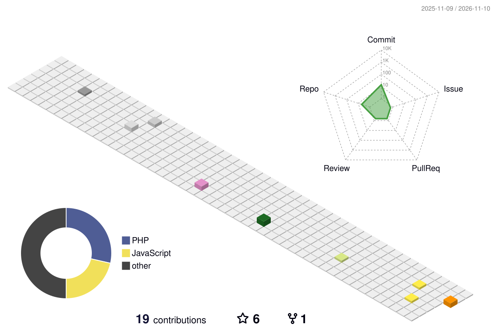

<!-- ═══════════════════════════ HEADER ═══════════════════════════ -->


<div align="center">

<a href="https://github.com/Brunoo47">
  
</a>

<br/>


<a href="https://github.com/Brunoo47?tab=followers"></a>
<a href="mailto:brunoostroskiprogramador@gmail.com"></a>


</div>

<br/>

## `> cat sobre-mim.php`

```php
<?php

final class Bruno extends Developer
{
    public string  $local    = 'Joinville - SC 🇧🇷';
    public array   $trabalho = ['@ultralims' => 'LIMS / sistemas de laboratório', '@NexusGen-Projetos' => 'IA & side projects'];
    public array   $stack    = ['PHP' => 'Slim', 'Java' => 'Spring Boot', 'TS' => 'Next.js'];
    public array   $agora    = ['APIs em PHP + Slim', 'agentes de IA', 'automatizar tudo que se repete 2x'];
    public string  $café     = '☕ ∞';

    public function contato(): string
    {
        return 'brunoostroskiprogramador@gmail.com';
    }
}
```

## `> ls ./stack`

<p align="center">
  <br/>
  
</p>

## `> gh dashboard`

<p align="center">
  <picture>
    <source media="(prefers-color-scheme: dark)" srcset="./assets/dashboard-dark.svg" />
    
  </picture>
  <sub>🤖 gerado todo dia por um <a href="./.github/scripts/dashboard.mjs">script próprio</a> rodando no <a href="./.github/workflows/profile.yml">GitHub Actions</a> — zero serviços de terceiros</sub>
</p>

<p align="center">
  <picture>
    <source media="(prefers-color-scheme: dark)" srcset="./assets/3d-dark.svg" />
    
  </picture>
</p>

## `> ls ./projetos --destaque`

<table>
  <tr>
    <td width="50%" valign="top">
      <h3>🚒 <a href="https://github.com/Brunoo47/Sistema-Bombeiros">Sistema Bombeiros</a></h3>
      <p>Sistema web para o Corpo de Bombeiros de Guaramirim — front-end do ecossistema de gestão.</p>
      
      
    </td>
    <td width="50%" valign="top">
      <h3>🗄️ <a href="https://github.com/Brunoo47/Django">Bombeiros · API</a></h3>
      <p>Banco de dados e back-end em Django do sistema dos bombeiros de Guaramirim.</p>
      
      
      
    </td>
  </tr>
  <tr>
    <td width="50%" valign="top">
      <h3>🤖 <a href="https://github.com/Brunoo47/demolay-ai-assistant">DeMolay AI Assistant</a></h3>
      <p>Agente de IA que responde dúvidas sobre a Ordem DeMolay.</p>
      
      
    </td>
    <td width="50%" valign="top">
      <h3>☁️ <a href="https://github.com/Brunoo47/app-aws">app-aws</a></h3>
      <p>Projeto base para integrar serviços da AWS com PHP e AWS SDK.</p>
      
      
      
    </td>
  </tr>
</table>

<details>
  <summary><b>🥚 <code>> sudo rm -rf /tédio</code></b> (clica aí)</summary>
  <br/>
  <p align="center">
    <br/><br/>
    
  </p>
  <p align="center"><sub>uma piada e uma frase novas a cada visita 🎲</sub></p>
</details>

<br/>

<p align="center">
  <picture>
    <source media="(prefers-color-scheme: dark)" srcset="./assets/snake-dark.svg" />
    
  </picture>
</p>


